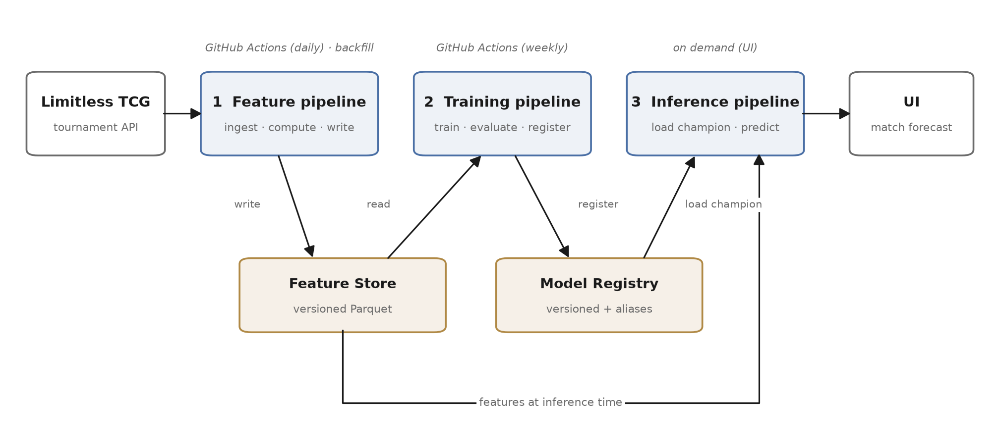

# optcg-swiss-forecast

Predicting One Piece Card Game Leader matchup probabilities from tournament results.

Semester project for I.BA_MLOPS, BSc Artificial Intelligence & Machine Learning,
Hochschule Luzern, HS26.

## What this is

One Piece Card Game is a competitive trading card game. Each player uses a Leader
and a 50-card deck. The Leader shapes how the deck is built and played.

The planned platform will let players compare recent Leader win rates and estimate
the probability that Leader A wins against Leader B. Match counts will show how much
evidence supports the statistics. There is one ML prediction task; the recent win
rates are descriptive statistics, not a second forecast.

The scope is decided Swiss-round matches from Limitless tournaments with at least
32 players, from September 2024 onward. Swiss is a tournament format, not a
restriction to Switzerland. Top cut, byes, draws and matches without a recorded
winner are excluded.

Different deck builds, player decisions, card interactions and luck affect results.
The core model will learn from observed Leader-level outcomes, not simulate card
effects or separate player skill from deck strength. Full decklists are optional
later work. New card sets can change deck builds and matchup outcomes, which is why
the eventual system will keep collecting data and retraining.

## Current status

5 November 2026: the MS2 pipeline implements checked-event backfill, daily
refresh and candidate discovery, earlier-history features, source snapshots and
verified Hopsworks storage. The current local backfill contains 1,290 matches from
eight checked events between June and September 2025. Docker reproduced that table
exactly without network access. A live daily run starting with an empty local
data folder saved and read back all 1,290 rows in `match_features_draft` v1. It
restored the existing history and 30 candidates awaiting review. A separate check
also recovered the new saved review list. The [GitHub CI run](https://github.com/kianakiser/optcg-swiss-forecast/actions/runs/42110953269) passed the tests and built and started Docker.
The dataset is a small demonstration, not a complete historical training set.

To verify collection, open [scheduled runs](https://github.com/kianakiser/optcg-swiss-forecast/actions/workflows/features.yml?query=event%3Aschedule), select a run and its `update` job, then open “Refresh checked events and store their features.”
The [5 November manual cloud check](https://github.com/kianakiser/optcg-swiss-forecast/actions/runs/42111485827) also verified all 1,290 rows and preserved 34 tournaments awaiting review.
Its last lines report the row count after reading the saved table back.
The public log can be read without a Hopsworks account.

On 5 November, a temporary macOS calendar timer automatically started the [GitHub cloud job](https://github.com/kianakiser/optcg-swiss-forecast/actions/runs/42116342596). The job reported 35 tournaments awaiting review, saved a source snapshot and verified all 1,290 stored rows. [Timing and trigger evidence](docs/MS2_SCHEDULE_EVIDENCE.md).

The [two-page summary](docs/ms2_summary.pdf) and its
[editable draft](docs/MS2_REVIEW_DRAFT.md) record achievements and every feedback
response. The [feature walkthrough](docs/FEATURE_WALKTHROUGH.md) follows one real match. The [API access question](docs/API_ACCESS_DRAFT.md) received a support reply on 4 November confirming the proposed request rate was acceptable. Storage and attribution were not specifically addressed.

| Milestone | Due | Status |
|---|---|---|
| MS1: Proposal | 2026-10-01 | Proposal in [`docs/proposal.pdf`](docs/proposal.pdf) |
| MS2: Feature pipeline | 2026-11-05 | Feature pipeline and cloud storage verified; see the run evidence above |
| MS3: Training pipeline | 2026-12-03 | Not started |
| MS4: Live system | 2027-01-10 | Not started |

Implementation follows the module milestones. A separate personal data collection
supplied the initial example; the coursework pipeline is implemented here.

## Run the feature pipeline

Install the locked dependencies with `uv sync --locked`. Supported Python is
3.12 through 3.14; the container and CI use 3.12. Run the checks with
`uv run --locked pytest -q`. All 92 tests pass on local Python 3.14 and on Linux
AMD64 Python 3.12, using the same commands planned for CI.

```sh
uv run --locked src/optcg/features/run.py --mode backfill
uv run --locked src/optcg/features/run.py --mode daily
uv run --locked src/optcg/features/run.py --mode daily --publish
```

`backfill` processes the events in `config/approved_events.json`, reusing cached
sources when available. `daily` downloads those events again and checks the latest
100 entries on the completed-event listing for new IDs. New IDs go to
`data/pending_events.json` for eligibility review. They are **not automatically
admitted**: completion, individual Standard format, participant count and Swiss
structure must be checked before adding an event and its evidence to the config.
The current config approves eight checked events. This is a bounded example;
it does not cover all eligible historical tournaments.

Both modes calculate the same features and save local history, features and dated
source snapshots under ignored `data/`. Each snapshot records fetch times, source
fields needed for the joins, eligibility evidence and exclusions. Player IDs are
retained privately for joins; player names, countries and full decklists are not
retained in the saved standings. These are minimized snapshots, not full API dumps.

`--publish` restores match history from Hopsworks, archives the new source snapshot
in project `Resources`, writes `match_features_draft` v1 and reads back every row
to check keys, labels and values. It asks for a hidden API key or accepts
`HOPSWORKS_API_KEY`. `.env.example` lists the variable; `.env` files are not loaded
automatically. Never commit a key or source data.

Published daily runs also restore the pending review list from Hopsworks Resources,
merge it with local and newly discovered IDs, and remove approved events. A separate
dated checkpoint keeps older candidates available when they leave the latest page.
Both the older source-snapshot recovery and the new checkpoint recovery have been
verified against Hopsworks, alongside the automated tests.
Discovery is not a complete historical crawl.

The earlier CSV commands remain available for a small isolated example:

```sh
uv run --locked src/optcg/features/prepare.py data/smoke_matches/*.csv --output data/features/smoke.csv
uv run --locked src/optcg/features/store.py data/smoke_matches/*.csv
```

`store.py` writes the separate `match_features_smoke` group. The pipeline's draft
group leaves that original storage check separate. For a new checkout, `run.py`
downloads the eight configured public events without requiring private CSVs.

The [feature walkthrough](docs/FEATURE_WALKTHROUGH.md) traces one real row. The
archive does not prove when old results first became available, so a correct
date-based calculation alone cannot establish a faithful historical replay.

## Container and scheduled run

```sh
docker build --platform linux/amd64 -t optcg-features .
docker run --rm --platform linux/amd64 optcg-features --help
```

Linux AMD64 is required by the installed Hopsworks Delta client's wheel support.
The container runs as a non-root user and includes code/config, not local data or
credentials. CI installs the locked packages, runs the tests and builds this image.
The Linux AMD64 image built successfully. Its help command and an offline cached
backfill both passed. All 1,290 output rows matched the local calculation exactly.
This checks execution in the container, not cloud publishing or the GitHub runner.

The daily GitHub workflow runs at 21:17 UTC with a 30-minute timeout.
The repository variable `ENABLE_DAILY_FEATURES=true` enables scheduled collection.
GitHub supplies `HOPSWORKS_API_KEY` from the repository’s Actions secrets.
For a local backfill, follow the instructions above. It does not need a Hopsworks key.
The cloud key used at MS2 expires on 11 November and must be renewed for later runs.

## Data and evaluation plan

Results come from [Limitless TCG](https://play.limitlesstcg.com) through its public
JSON API. The local draft backfills approved events and discovers candidates for review.
Broader historical coverage and ongoing API-use confirmation remain open.

Inputs will include the two Leader IDs, earlier Leader win rates, the earlier rate
for the exact pairing, and each Leader's preceding 28-day win rate. Every rate will
have its supporting match count. For historical examples, features will use only
earlier tournament dates, treating events on the same date as simultaneous.

The label is 1 if the first listed player wins and 0 if that player loses. Models
will be evaluated on later tournaments, using Brier score. The target is below
0.25 and better than a historical Leader-matchup lookup on the same test matches.
Whether ML improves on the baseline has not yet been tested.

## Tools and planned roles

| Tool | Planned role and reason |
|---|---|
| Hopsworks | Store prepared features for training and prediction; a module-supported option |
| Weights & Biases | Track training runs and version models; I have used W&B before, and the module allows it |
| GitHub Actions | Schedule jobs and run automated checks alongside the code |
| Python and scikit-learn | Prepare tabular features and train a manageable gradient boosting classifier |
| FastAPI, Docker and Google Cloud Run | Provide and host a containerised prediction endpoint |
| pytest and uv | Test the calculations and pin dependencies for reproducible environments |

Accounts, permissions and service availability will be checked when those
components are implemented. No free hosting or service plan is assumed.

## Planned architecture



- Feature pipeline: collect results daily, calculate historical rates and save
  features and labels. Backfill uses the same logic for historical results.
- Training pipeline: read prepared examples weekly, train and evaluate a model,
  compare baselines and register a model version with its scores in W&B.
- Inference pipeline: use the selected model and current matchup features to
  return a probability, recent win rates and match counts when a player asks.

The three pipelines will run separately through shared storage. Basic job logging,
deployed model identification and monitoring of changes in Leader usage belong to
the planned core final system. A detailed monitoring dashboard and full-decklist
experiments are optional, after the core works reliably.

## Proposal files

- [`docs/proposal.pdf`](docs/proposal.pdf): current two-page PDF exported from the editable Google Doc.
- [`docs/src/proposal.typ`](docs/src/proposal.typ): matching proposal text in Typst; its rendered spacing may differ.
- [`docs/src/architecture.svg`](docs/src/architecture.svg): editable diagram source.

The [editable Google Doc](https://docs.google.com/document/d/16V8yJXAAz7TQf7Jd8lgIvCZbn6qMrVYod0yi1b4yUc0)
is the current editing master. Export it as PDF to preserve its exact layout.

To render an alternative PDF with [Typst](https://typst.app):

```sh
typst compile docs/src/proposal.typ /tmp/optcg-proposal-typst.pdf
```

The PDF and Typst text reflect the revised editable proposal as of 1 October
2026. Later Google Doc edits must be synchronised explicitly; there is no automatic
Drive-to-GitHub sync. Previously submitted coursework remains a separate archive.
